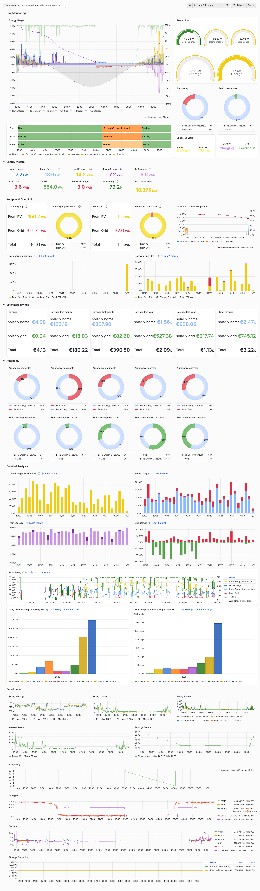

# Fronius Grafana Dashboard for VictoriaMetrics

Grafana dashboard for Fronius inverters (Symo GEN24, Smart Meter, battery) with
**json-exporter + VictoriaMetrics** instead of Telegraf + InfluxDB.

This is a fork of [chpro/fronius-grafana-dashboard](https://github.com/chpro/fronius-grafana-dashboard).
The dashboard layout and panels are the original work of chpro; this fork replaces the data pipeline and
rewrites every query in MetricsQL.

**Disclaimer:** This project is intended for advanced users who are comfortable with data visualization and
Fronius systems. No support or warranty is provided. Use at your own risk.



## What is different from the original

- **No Telegraf, no InfluxDB:** [json-exporter](https://github.com/prometheus-community/json_exporter) turns the
  Fronius Solar API into Prometheus metrics, VictoriaMetrics scrapes and stores them.
- **History can be migrated:** metric names are identical to what Telegraf wrote to InfluxDB, see
  [migration/influxdb-to-victoriametrics.md](migration/influxdb-to-victoriametrics.md).
- **Fewer Grafana plugins:** the power flow gauges read from VictoriaMetrics too, so Grafana no longer talks to
  the inverter directly (no Infinity/JSON datasource needed).
- **Correct calendar days in any timezone, including daylight saving time changes:** daily bars use local
  midnight in the configured timezone.
- **Energy prices as dashboard variables** instead of an InfluxDB bucket. Savings are calculated per hour, so
  price changes are applied exactly when they take effect.
- **Balcony power plant** (optional, measured by a Shelly plug) is added to production, home usage, autonomy
  and savings (see [Balcony power plant](#balcony-power-plant)).
- **Wattpilot & Ohmpilot:** energy into the car and into hot water, split into PV and grid
  (see [Wattpilot and Ohmpilot](#wattpilot-and-ohmpilot)).
- **Readable on tablets and phones:** autonomy and self consumption as percent gauges (today, yesterday,
  this/last month, this/last year), short panel titles and tiles wide enough for portrait mode.
- **Docker Compose and Kubernetes** deployment included.

## Architecture

```
Fronius inverter ──(Solar API v1, HTTP/JSON)──> json-exporter :7979
                                                      ▲
                                                      │ scrape /probe every 60s
                                                      │
forecast.solar ──> fetch-forecast.sh ──(CSV import)──> VictoriaMetrics :8428 ──> Grafana
                                                      │
Fronius Wattpilot ──(WebSocket)──> wattpilot-exporter :9101 (optional)
Shelly plug (balcony power plant) ──(HTTP/JSON)──> json-exporter (optional)
```

The Ohmpilot is read through the inverter's Solar API (json-exporter module `fronius_ohmpilot`).

## Requirements

- Fronius inverter with **Solar API v1 enabled** (inverter web UI → Communication → Solar API).
  Developed with Symo GEN24 10.0, Smart Meter TS 65A-3 (meter location: grid interconnection point) and
  BYD Battery-Box Premium HVS. Min/max values in the panels match this setup.
- **VictoriaMetrics** (single-node or cluster/vmagent). Plain Prometheus is not enough: the queries use
  MetricsQL functions such as `first_over_time`, `sum_gt_over_time` and `timezone_offset`.
- **Grafana 11 or newer** with these plugins:
  - [VictoriaMetrics datasource](https://grafana.com/grafana/plugins/victoriametrics-metrics-datasource/)
  - [Sun and Moon](https://grafana.com/grafana/plugins/fetzerch-sunandmoon-datasource/) (sun altitude in the
    "Energy Usage" panel), configured with your latitude/longitude
- Optional: a [forecast.solar](https://forecast.solar) URL for the "Expected yield" panel.
- Optional: a **balcony power plant** behind a Shelly Gen2+/Gen3 plug, see
  [Balcony power plant](#balcony-power-plant).
- Optional: Fronius **Wattpilot** and/or **Ohmpilot** for the "Wattpilot & Ohmpilot" row, see
  [Wattpilot and Ohmpilot](#wattpilot-and-ohmpilot).

## Quick start with Docker Compose

Starts json-exporter, VictoriaMetrics and Grafana with provisioned datasources and dashboard.

```bash
cd docker-compose
cp .env.example .env    # set FRONIUS_HOST, LATITUDE, LONGITUDE, GRAFANA_ADMIN_PASSWORD
docker compose up -d
# with forecast (set FORECAST_URL in .env first):
docker compose --profile forecast up -d
# with Wattpilot (set WATTPILOT_HOST and WATTPILOT_PASSWORD in .env first):
docker compose --profile wattpilot up -d
```

Profiles can be combined (`--profile forecast --profile wattpilot`).

Open Grafana at <http://localhost:3000> and the dashboard **Fronius PV (VictoriaMetrics)**.
Then set timezone and prices, see [Dashboard settings](#dashboard-settings).

## Kubernetes

The repository root is a kustomization that deploys json-exporter, the Wattpilot exporter, the forecast CronJob
and the dashboard as a ConfigMap for the Grafana sidecar (label `grafana_dashboard: "1"`, as used by kube-prometheus-stack and the
Grafana Helm chart). VictoriaMetrics and Grafana are expected to exist already.

```bash
kubectl create namespace monitoring
kubectl -n monitoring create secret generic pv-forecast \
  --from-literal=FORECAST_URL='https://api.forecast.solar/estimate/watthours/<lat>/<lon>/<dec>/<az>/<kwp>?time=utc'
kubectl -n monitoring create secret generic wattpilot --from-literal=WATTPILOT_PASSWORD='<password>'
kubectl apply --server-side -k .
```

Without a Wattpilot, remove `kubernetes/wattpilot-exporter.yaml` and the `wattpilot-exporter-script` generator
from [kustomization.yaml](kustomization.yaml) (and skip the `wattpilot` secret).

For Argo CD or Flux, point an application at this repository (or a fork of it) and override the namespace with
an overlay if needed. Adjust `VM_URL` in [kubernetes/pv-forecast-cronjob.yaml](kubernetes/pv-forecast-cronjob.yaml)
to your VictoriaMetrics service and `WATTPILOT_HOST` in
[kubernetes/wattpilot-exporter.yaml](kubernetes/wattpilot-exporter.yaml) to your Wattpilot.

Then add the scrape jobs from [victoriametrics/scrape.yml](victoriametrics/scrape.yml) to your VictoriaMetrics or
vmagent config, with `json-exporter:7979` replaced by `json-exporter.monitoring.svc:7979` and
`wattpilot-exporter:9101` by `wattpilot-exporter.monitoring.svc:9101`. Set the environment variable
`FRONIUS_HOST` on VictoriaMetrics/vmagent (or replace `%{FRONIUS_HOST}` directly) and add
`-search.maxPointsSubqueryPerTimeseries=1100000` to VictoriaMetrics (see
[Wattpilot and Ohmpilot](#wattpilot-and-ohmpilot)).

## Using an existing VictoriaMetrics and Grafana

1. Run json-exporter with [json-exporter/config.yml](json-exporter/config.yml).
2. Add the scrape job from [victoriametrics/scrape.yml](victoriametrics/scrape.yml).
3. For the forecast: start VictoriaMetrics with `-futureRetention=7d` (forecast values have timestamps in the
   future) and run [forecast/fetch-forecast.sh](forecast/fetch-forecast.sh) every 15 minutes.
4. Optional: run [wattpilot-exporter/wattpilot_exporter.py](wattpilot-exporter/wattpilot_exporter.py) for the
   Wattpilot and start VictoriaMetrics with `-search.maxPointsSubqueryPerTimeseries=1100000`, see
   [Wattpilot and Ohmpilot](#wattpilot-and-ohmpilot).
5. Import [grafana/dashboard.json](grafana/dashboard.json) (Dashboards → New → Import) and select your
   VictoriaMetrics datasource in the variable at the top of the dashboard.

## Wattpilot and Ohmpilot

The row "Wattpilot & Ohmpilot" shows how much energy went into the car (Wattpilot) and into hot water
(Ohmpilot), split into **PV** and **grid**, for the selected time range and per day, plus live power and the
boiler temperature. Each device works on its own; without one of them its panels stay at 0.

### Ohmpilot

Nothing to do if the `fronius_ohmpilot` target in [victoriametrics/scrape.yml](victoriametrics/scrape.yml) is
active: the inverter forwards the Ohmpilot values (`ohmpilot_PowerReal_PAC_Sum`, `ohmpilot_EnergyReal_WAC_Sum_Consumed`,
`ohmpilot_Temperature_Channel_1`). History imported from InfluxDB is used as well.

### Wattpilot

The Wattpilot has no HTTP API (its IP answers every URL with 404), only a password protected WebSocket at
`ws://<wattpilot>/ws`. [wattpilot-exporter/wattpilot_exporter.py](wattpilot-exporter/wattpilot_exporter.py)
(Python standard library only, no own image) keeps that connection open and serves the last values on
`:9101/metrics`. Data is collected from the start of the exporter; the Wattpilot does not provide history.

- **Password:** there is no user name. The password is the one set during setup in the Solar.wattpilot app
  (on some installations the same as for the inverter). If it is lost, reset it in the app with the reset card.
- **Firmware:** tested with Wattpilot firmware 42.x (`pbkdf2` login). The bcrypt login of the Wattpilot Flex
  is not supported.
- **Docker Compose:** set `WATTPILOT_HOST` and `WATTPILOT_PASSWORD` in `.env`, then
  `docker compose --profile wattpilot up -d`.
- **Kubernetes:** see [Kubernetes](#kubernetes).
- **Test locally** (the password is read without echo):

  ```bash
  read -s "PW?Wattpilot password: "   # bash: read -s -p "Wattpilot password: " PW
  WATTPILOT_PASSWORD=$PW WATTPILOT_HOST=<wattpilot> python3 wattpilot-exporter/wattpilot_exporter.py
  curl localhost:9101/metrics   # in a second terminal
  ```

  The log shows `connected to <name> (firmware ...)` or `login failed`. After a failed login the exporter waits
  5 minutes before the next attempt. Stop the test before deploying: the Wattpilot accepts only a few
  connections.

| Metric | Meaning |
|---|---|
| `wattpilot_up` | 1 if logged in and data is current |
| `wattpilot_power`, `wattpilot_power_L1..L3` | charging power in W |
| `wattpilot_voltage_L1..L3`, `wattpilot_current_L1..L3` | voltage in V, current in A |
| `wattpilot_energy_total` | energy charged in total in Wh |
| `wattpilot_energy_session` | energy charged since the car was connected in Wh |
| `wattpilot_car_state` | 1 idle, 2 charging, 3 waiting for car, 4 complete (also shown while Eco mode pauses), 5 error |
| `wattpilot_charging_allowed` | 1 if the car may charge right now |
| `wattpilot_current_limit` | requested charging current in A |
| `wattpilot_logic_mode` | 3 default, 4 eco (PV surplus), 5 next trip |
| `wattpilot_error` | error code, 0 = no error |
| `wattpilot_info` | labels `serial`, `friendly_name`, `version`, `devicetype` |

### PV/grid split

No device measures where its energy comes from, so the split is estimated
per minute. Grid import at the grid connection point (`powerflow_P_Grid > 0`) is attributed to Wattpilot and
Ohmpilot first, up to their combined power, and divided between both by power. The rest of their consumption
counts as PV. Consequences:

- Energy from the **battery** counts as PV (stored solar energy).
- A **balcony power plant** or any other generator behind the grid meter is included in PV automatically,
  because it reduces the measured grid import.
- Short load peaks within a minute are not visible.
- Selected time ranges longer than about 69 days need `-search.maxPointsSubqueryPerTimeseries=1100000` on
  VictoriaMetrics (already set in the Compose setup), otherwise the panels show an error.

## Balcony power plant

A balcony power plant (plug-in solar) feeds in behind the grid meter. The Fronius smart meter only sees it as
less grid import, so without extra data the dashboard undercounts production and home usage. Most balcony
inverters (e.g. TSUN) have no local API, so the plant is measured with a
**Shelly Gen2+/Gen3 plug** (e.g. Shelly Plug S Gen3) between inverter and socket.

1. Plug the inverter into the Shelly. Feed-in shows up as negative power and in the "returned energy" counter.
   Check with `http://<shelly>/rpc/Switch.GetStatus?id=0` (`apower` < 0 and `ret_aenergy.total` rising while
   the sun shines). Keep "reverse" off in the Shelly settings.
2. Enable the `balcony` job in [victoriametrics/scrape.yml](victoriametrics/scrape.yml) with the IP of the
   Shelly. json-exporter module: `shelly_balcony` in [json-exporter/config.yml](json-exporter/config.yml).

The dashboard uses `balcony_ret_aenergy_total` (Wh, via `increase()`, so counter resets do no harm) and
`balcony_apower` (W):

- Production, home usage, local consumption, autonomy, self consumption and savings include the balcony
  energy. "Local Energy Production" (daily bars) shows Fronius and balcony stacked, the stat
  "Balcony" in "Energy Meters" shows the balcony share.
- Live panels: solar power and home usage include the balcony power. The balcony power is also shown on its
  own (orange line "Balcony" in "Energy Usage", gauge "Balcony" in "Power flow"). The autonomy line in "Energy Usage" is
  calculated as `1 − grid import / home usage` instead of the inverter's `rel_Autonomy`.
- Not included: "Lifetime production" (lifetime counter of the inverter) and the "grouped by kW"
  panels (inverter power only).
- Without balcony data every balcony term is 0, the dashboard shows the same values as before. History starts
  when the Shelly is scraped.

### History from the TSUN cloud

TSUN micro inverters report to talent-monitoring.com. [scripts/tsun-import.py](scripts/tsun-import.py) turns
its history into `balcony_apower{source="tsun"}` and `balcony_ret_aenergy_total{source="tsun"}` for the time
before the Shelly plug. The dashboard sums all balcony series, so production, autonomy and savings include the
imported history without further changes. The script uses two requests of the portal's web page:

- `exportChartData`: 5 minute AC power, downloaded week by week. The portal keeps these only for a limited
  time (in one case from September 2023 on, for a plant online since April 2023).
- `selectChartData` with `group=day`: the daily yield, one request per month, available since the start.

Days with 5 minute values keep their power curve, the counter is scaled up by the few percent the daily yield is
higher. If hours of a day are missing, the rest of the daily yield goes to these hours, spread like a typical solar
day. Days with only a daily yield get it spread over the whole day that way (no power curve).

1. Log in to talent-monitoring.com and open the device. In the browser dev tools (Network, filter `ChartData`)
   a request shows the `deviceGuid` and the `Authorization` header.
2. Download and convert (the token is read without echo; downloads are cached in `tsun-cache/`, a second run
   only fetches what is missing, e.g. after the token expired):

   ```sh
   read -rs TSUN_TOKEN && export TSUN_TOKEN
   python3 scripts/tsun-import.py --device <deviceGuid> --since <first day> --until <first Shelly sample, e.g. 2026-11-03T12:10:00Z>
   ```

   `--until` must be the time the Shelly data starts, otherwise energy is counted twice.
3. Import: `curl -X POST --data-binary @tsun-import.jsonl http://localhost:8428/api/v1/import`.
   To undo: `curl 'http://localhost:8428/api/v1/admin/tsdb/delete_series?match[]={source="tsun"}'`.

The portal API is unofficial and may change. The export is requested in UTC, the daily yields are local days
(`--tz`, default `Europe/Berlin`). If the portal times out (HTTP 504), the script retries and falls back to
single days, also after network errors. On a Mac, prefix the command with `caffeinate -i` so it does not
stop when the Mac goes to sleep. Compared with a Shelly plug the TSUN values are about 1–3 % higher.

## Dashboard settings

Dashboard settings → Variables:

| Variable | Default | Meaning |
|---|---|---|
| `datasource` | first VictoriaMetrics datasource | datasource for all metric panels |
| `sunandmoon` | first Sun and Moon datasource | sun altitude |
| `tz` | `Europe/Berlin` | IANA timezone for calendar days. Should match the dashboard/browser timezone. |
| `price_buy` | `0.30` | price per kWh drawn from the grid |
| `price_sell` | `0.08` | feed-in tariff per kWh |

Savings are shown in EUR; change the unit of the savings panels if you use another currency.

Prices can change over time. Use a MetricsQL expression with `time()` (Unix timestamp of the change), e.g.

```
(0.35 * (time() < bool 1772319600) + 0.25 * (time() >= bool 1772319600))
```

for 0.35 until 2026-03-01 00:00 CET and 0.25 afterwards. Add one term per price period.

Save the dashboard after changing variables. With file provisioning, set `allowUiUpdates` (already done in the
Compose setup) or edit the defaults in `grafana/dashboard.json`.

## How the numbers are calculated

- **Energy within the selected time range** (stat panels): difference of the meter counters
  (`powerflow_E_Total`, `smartmeter_EnergyReal_WAC_Plus_Absolute`, `smartmeter_EnergyReal_WAC_Minus_Absolute`)
  between start and end of the range. Battery energy is integrated from `powerflow_P_Akku`.
- **Daily bars:** VictoriaMetrics aligns daily steps to 00:00 UTC. The queries therefore evaluate the counters
  on an hourly grid, pick the local midnight in `tz` and subtract the counter at the previous local midnight.
  Days with 23 or 25 hours (DST changes) are handled correctly.
- **Balcony power plant:** `increase()` of the Shelly's returned-energy counter in the same period, added to
  the inverter production.
- **Wattpilot/Ohmpilot:** integrated from the power values per minute, see
  [PV/grid split](#pvgrid-split).
- **Savings:** for every hour, `(production − feed-in) × price_buy + feed-in × price_sell`, summed over the range.

Production = inverter + balcony power plant. Home usage = production − feed-in + grid draw. Autonomy = self-consumed production / home usage.

## Checking the queries

[scripts/check-queries.py](scripts/check-queries.py) runs every dashboard query against your VictoriaMetrics and
lists errors and empty results (some are expected, e.g. "Grid down" when the grid never failed, "Wattpilot" without a running
wattpilot-exporter or "Balcony" without balcony data):

```bash
python3 scripts/check-queries.py http://localhost:8428 --tz Europe/Vienna
```

## Known limitations

- Timezones with a non-hour UTC offset (e.g. India, +05:30) shift daily boundaries by up to 30 minutes.
- Daily battery energy on DST change days is extrapolated from 24 hours of data. Daily Wattpilot/Ohmpilot and
  balcony energy on these days covers 24 hours instead of 23/25.
- The "Energy Production & Cost Summary" dashboard of the original project has not been ported.
- Panels rely on metric names only. If you scrape several inverters into the same VictoriaMetrics, add label
  filters to the queries.

## Migrating from the original (Telegraf + InfluxDB)

See [migration/influxdb-to-victoriametrics.md](migration/influxdb-to-victoriametrics.md).

## Credits

- Dashboard and original Telegraf/InfluxDB setup: [chpro/fronius-grafana-dashboard](https://github.com/chpro/fronius-grafana-dashboard)
- [Grafana](https://github.com/grafana/grafana), [VictoriaMetrics](https://github.com/VictoriaMetrics/VictoriaMetrics),
  [json_exporter](https://github.com/prometheus-community/json_exporter), [forecast.solar](https://forecast.solar)

The original project credits:

- [Powerwall Dashboard by jasonacox](https://github.com/jasonacox/Powerwall-Dashboard)
- [Fronius-to-Influx by szymi-](https://github.com/szymi-/fronius-to-influx)
- [Solar Panel Monitoring with Telegraf](https://gist.github.com/farmio/618ca3c1b3f335dd966b19a92acef832)
- [How I Created a Telegraf Plugin to Monitor Solar Panels](https://thenewstack.io/how-i-created-a-telegraf-plugin-to-monitor-solar-panels/)

## License

MIT, see [LICENSE](LICENSE). Original work © 2023 chpro.
